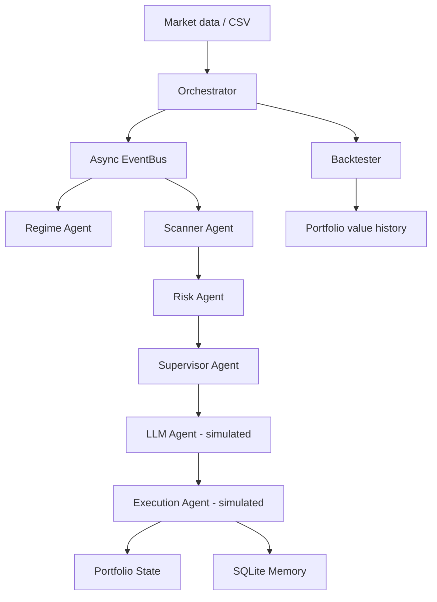

# Multi-Agent Trading Framework (MATF)

Framework experimental de trading multiagente, orientado a eventos e desenvolvido em Python.

> **Estado atual: protótipo de investigação.** Os agentes e o backtester ainda contêm lógica demonstrativa. Este repositório não deve ser utilizado para negociação com capital real nem as suas mensagens de IA devem ser interpretadas como recomendações financeiras.

## Objetivos

- Separar responsabilidades por agentes especializados.
- Coordenar agentes através de um barramento assíncrono de eventos.
- Experimentar pipelines de análise de mercado e gestão de risco.
- Criar uma base testável para simulação e investigação quantitativa.

## Estado funcional conhecido

| Componente | Estado observado | Limitação relevante |
|---|---|---|
| EventBus | Implementado | Dispatcher em memória; sem persistência ou garantias de entrega |
| Orchestrator | Implementado | Atualiza contexto e publica eventos |
| RegimeAgent | Protótipo | Define o regime como `BULL` sem análise quantitativa |
| ScannerAgent | Protótipo | Emite uma oportunidade demonstrativa |
| RiskAgent | Protótipo | Aprova oportunidades sem cálculo efetivo de risco |
| LLMAgent | Simulação | Produz texto determinístico; não consulta um modelo LLM |
| ExecutionAgent | Simulação | Acrescenta um valor fixo ao portefólio; não representa uma execução realista |
| Backtester | Básico | Regista o valor do portefólio; não calcula fills, comissões, slippage ou funding |

Estas limitações são intencionais nesta fase de documentação: não se apresentam componentes experimentais como funcionalidades de produção.

## Arquitetura



## Requisitos

- Python 3.10 ou superior.
- Git.
- Dependências Python declaradas em `pyproject.toml`.

## Instalação

```bash
git clone https://github.com/smpsandro1239/AiCryptoMultiAgente.git
cd AiCryptoMultiAgente

python -m venv .venv
```

Ativar o ambiente virtual:

**Linux/macOS**
```bash
source .venv/bin/activate
```

**Windows PowerShell**
```powershell
.venv\Scripts\Activate.ps1
```

Instalar dependências e ferramentas de desenvolvimento:

```bash
python -m pip install --upgrade pip
python -m pip install -e ".[dev]"
```

## Testes e qualidade

```bash
pytest
ruff check .
ruff format --check .
```

O pipeline de CI executa testes e verificações de lint nos ficheiros de núcleo e testes. A aprovação do CI não equivale a validação de uma estratégia de trading nem a prova de rentabilidade.

## Executar o exemplo

O exemplo aceita um ficheiro CSV de mercado. Para permanecer executável sem dados externos, solicita explicitamente candles sintéticos:

```bash
python examples/backtest_example.py
```

**Atenção:** o resultado atual é uma demonstração de fluxo de eventos. Não é um backtest financeiro fiável.

## Segurança

- Nunca guardar API keys, passwords ou tokens no repositório.
- Nunca ativar negociação real com esta versão experimental.
- Usar contas sandbox/testnet e permissões mínimas quando forem adicionadas integrações com exchanges.
- Não ativar permissões de levantamento nas chaves de API.
- Validar dados OHLCV, timestamps, duplicados e valores inválidos antes de qualquer análise.
- Consultar [SECURITY.md](SECURITY.md) para o processo de reporte.

## Roadmap

- [x] Documentar o estado real dos agentes e do simulador.
- [x] Melhorar o EventBus e adicionar testes de unidade.
- [x] Introduzir CI para testes e lint do núcleo.
- [x] Rejeitar dados OHLCV ausentes por omissão e validar candles CSV.
- [ ] Normalizar fusos horários, ordenação temporal e gaps.
- [ ] Definir contratos de eventos e schemas.
- [ ] Implementar sizing, exposição, drawdown e limites de risco reais.
- [ ] Implementar contabilidade de posições, ordens e fills.
- [ ] Modelar comissões, slippage, funding e latência no backtester.
- [ ] Separar explicitamente paper trading de qualquer integração live.
- [ ] Adicionar testes de integração com exchange sandbox.

## Licença

MIT — consultar o ficheiro `LICENSE`.
